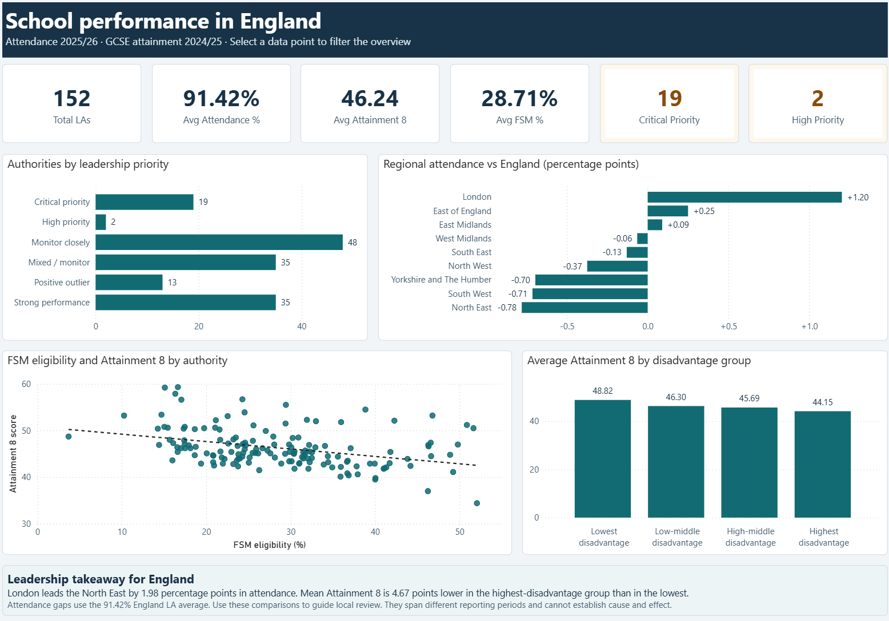

# England School Performance Analytics

**Dare Tijani · SQL Server and Power BI portfolio project · 2026**

I built this report around a practical question for education leaders: **which local authorities warrant a closer look, and what does their regional context add?** I used SQL Server to combine three Department for Education datasets and Power BI to compare attendance, disadvantage and GCSE attainment across **152 local authorities in England**.



## Key findings

- **91.42% average attendance** across 151 authorities with reported rates. Knowsley recorded the lowest rate at **88.41%**, which was **3.01 percentage points** below the England local-authority mean.
- **4.67 Attainment 8 points** separated the lowest- and highest-disadvantage groups, whose means were **48.82** and **44.15**.
- The project’s benchmark rules flagged **19 critical-priority** and **2 high-priority** authorities for further review. These are project classifications, separate from official DfE designations.

## Report pages

| Page | Design decision |
| --- | --- |
| **Executive Overview** | A zero-centred chart shows how far each region’s attendance is above or below the England benchmark. Selecting a chart mark updates the six KPIs and companion charts. |
| [**Attendance Analysis**](assets/attendance-analysis.png) | The ranking keeps exact rates visible. A region filter updates the 15 lowest reported rates and the benchmarks for that area. |
| [**Disadvantage and Attainment**](assets/disadvantage-and-attainment.png) | Both regional charts use the same region order. Selecting a bar filters the authority table while the companion chart retains its comparison. |

## Data and validation

I staged three Department for Education extracts in SQL Server, cleaned the source fields, and joined the results at local-authority level. SQL reporting views supply the Power BI model. Each authority contributes equally to the mean of each available measure. Isles of Scilly remains in the authority count and is excluded from attendance averages and rankings because its rate is missing.

I reconciled the national KPIs and attendance ranks against SQL, then tested the interactions in Power BI Desktop.

| Desktop check | Result reconciled to SQL |
| --- | --- |
| Select West Midlands on Executive Overview | Six KPIs and three companion charts narrowed to 14 authorities. Clearing restored the England baseline. |
| Filter Attendance Analysis to North West | All 15 ranks matched. The cards showed 91.04% average attendance and a 2.63 percentage-point gap to the lowest rate. |
| Select North West and Critical priority on Disadvantage and Attainment | The table showed six authorities. The charts showed 40.93 mean Attainment 8 and 40.41% mean FSM eligibility. |

The SQL check below shows how I kept the authority count separate from attendance coverage. SQL Server excludes null attendance rates from the average.

```sql
SELECT
    COUNT(DISTINCT la_code) AS local_authorities,
    COUNT(attendance_percentage) AS authorities_with_attendance,
    AVG(CAST(attendance_percentage AS decimal(12, 4))) AS mean_attendance_pct
FROM dbo.vw_executive_dashboard;
```

The project combines 2025/26 attendance and school characteristics with 2024/25 GCSE attainment. Free school meal eligibility is a proxy for disadvantage. The comparisons are aggregate and descriptive, so they cannot establish pupil-level effects or causation.

[DfE school characteristics, 2025/26](https://explore-education-statistics.service.gov.uk/find-statistics/school-pupils-and-their-characteristics/2025-26) · [DfE attendance, 2025/26](https://explore-education-statistics.service.gov.uk/data-catalogue/data-set/f7acee77-7e09-4aaf-b973-ad514c355529) · [DfE Key stage 4 performance, 2024/25](https://explore-education-statistics.service.gov.uk/find-statistics/key-stage-4-performance/2024-25)

I can demonstrate the live report and explain the SQL and Power BI implementation during an interview.

© 2026 Dare Tijani. Original analysis, report design and case-study materials. Source data is credited to the Department for Education.
